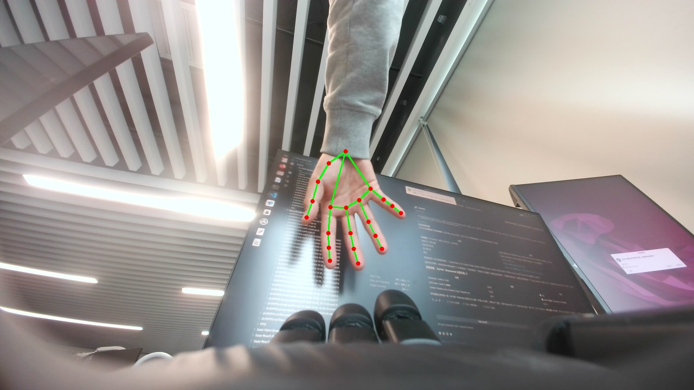

# DexPlay · 灵巧手互动游乐场

> 一台帕西尼 **DexH13** 灵巧手的 Python 驱动层 + 两个互动玩法 + 网页控制台。
> 不需要官方 SDK，不需要 ROS，Windows / Linux 都能直接跑。

<p align="center">
  
</p>

---

## 这是什么

DexH13 是帕西尼的四指多维触觉灵巧手（13 主动自由度 + 3 被动）。
官方 SDK 只提供 Linux 版本，且标注「适配固件 2.0 以上」——
手上这台是 **V1.4.4**，等于没有可用的二次开发工具。

这个项目把协议逆向出来，用纯 Python 重新实现了一层控制库，然后在其上做了两个玩法：

| 玩法 | 说明 |
|---|---|
| **猜拳** | 摄像头识别你的石头/剪刀/布，灵巧手出拳跟你对局 |
| **跟随模仿** | 你的手指怎么弯，灵巧手就怎么弯（连续重定向，非离散查表） |

外加一个**网页控制台**：浏览器里实时看画面，位置对了再点开始。

## 硬件

| 部件 | 型号 / 参数 |
|---|---|
| 灵巧手 | PaXini **DexH13** 右手，固件 `V1.4.4_D`，从站地址 `0x79` |
| 供电 | 24–48 V DC，3 A Max，纹波 ≤150 mV |
| 通信 | RS485 / Modbus RTU，**460800** 8N1 |
| USB-485 | Prolific **PL2303GR**（内置 RS485 收发器，VID `067B` / PID `23A3`） |
| 摄像头 | 任意 UVC 摄像头（1280×720 或 640×480 均可） |
| 主机 | Ubuntu 22.04 或 Windows 10/11 |

**RS485 线序**（线缆热缩管印 `MODBUS`）：

```
绿 → A    白 → B    黑 → GND    屏蔽线 → 悬空
```

详细接线、供电、排障见 [docs/HARDWARE.md](docs/HARDWARE.md)。

## 快速开始

```bash
# 1. 依赖
sudo apt install -y python3-serial python3-opencv      # Linux
pip install pyserial opencv-python mediapipe flask     # 或 pip

# 2. 下载手部关键点模型（约 7.8 MB）
bash scripts/fetch_model.sh

# 3. 确认手在哪
python3 lessons/l1_probe.py

# 4. 网页控制台
python3 web/app.py            # 打开 http://<本机IP>:8000
```

### 六节课（从零到会用）

| 文件 | 学什么 | 会动手吗 |
|---|---|---|
| `lessons/l1_probe.py` | 扫端口 × 波特率 × 地址，定位手 | ✗ |
| `lessons/l2_read.py` | 读版本 / 位置 / 电流 / 温度 / 电压 | ✗ |
| `lessons/l3_enable.py` | 使能与失能的五步时序 | 上电 |
| `lessons/l4_move.py` | 动一个关节再回位 | 动 1 个关节 |
| `lessons/l5_gesture.py` | 跑预设手势 | 全手 |
| `lessons/l6_record.py` | 采数据存 CSV | 全手 |

### 命令行玩法

```bash
python3 games/rps.py --rounds 5            # 猜拳 5 局
python3 games/mimic.py --seconds 30        # 跟随模仿 30 秒
```

无桌面环境也能用：两个脚本都会**录像到 `data/`**，跑完看视频即可。

## 架构

```
摄像头 ──> MediaPipe HandLandmarker ──> 21 个关键点
                                          │
                    ┌─────────────────────┴─────────────────────┐
                    │ 几何规则 → 石头/剪刀/布                    │
                    │ 指节夹角 → 每根手指屈曲度 → 13 维目标位置  │
                    └─────────────────────┬─────────────────────┘
                                          │
                            dexh13 库（Modbus RTU @460800）
                                          │
                                     DexH13 灵巧手
```

| 模块 | 作用 |
|---|---|
| `dexh13/crc.py` | Modbus CRC16（0xA001，低字节在前） |
| `dexh13/protocol.py` | 寄存器地图与帧构造 |
| `dexh13/transport.py` | 串口一问一答、超时、扫描 |
| `dexh13/hand.py` | 高层 API（使能、读状态、动关节、手势） |
| `dexh13/gestures.py` | 11 组预设手势 |
| `games/rps.py` | 猜拳 |
| `games/mimic.py` | 跟随模仿（连续标定） |
| `web/app.py` | 网页控制台（Flask + MJPEG） |

协议细节见 [docs/PROTOCOL.md](docs/PROTOCOL.md)。

## 实测数据

| 指标 | 值 |
|---|---|
| Modbus 一问一答 | **1.13 ms** |
| 手部识别 | 30 FPS @640×480，检测率 100%（单帧约 17 ms） |
| 关节到位误差 | 目标 200 → 实际 199（满量程 4000） |
| 跟随下发频率 | 25 Hz（受相机帧率限制约 13–25 Hz） |

## 已知限制

- **触觉拿不到**：460800 只有约 46 KB/s，全量触觉需要 547 KB/s，
  实时采集必须先升固件到 2.0+（4 Mbps）或改用 EtherCAT。
- **只有 4 指**：拇指 + 食/中/无名，没有小指，模仿时小指不参与映射。
- **离散 vs 连续**：猜拳是查表，模仿是几何重定向，后者没有训练，靠标定。
- **没有力控**：力控在官方 SDK 里（需固件 2.0+）。
- **单目**：无深度、无标定，换机位要重新标定。

## 免责声明

本项目**不是**帕西尼官方项目。协议部分由逆向 `pxdex-h13` 上位机得到，
仅用于互操作与研究目的；相关商标与软件著作权归帕西尼（PaXini）所有。
使用前请确认符合你与厂商的约定。

## License

MIT（仅限本项目代码）。第三方依赖：MediaPipe、OpenCV（Apache-2.0）、pyserial（BSD）。